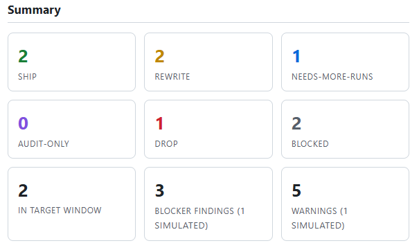
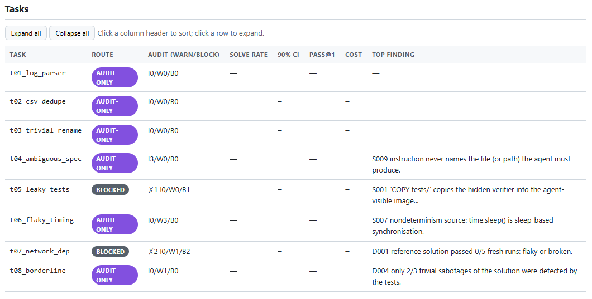
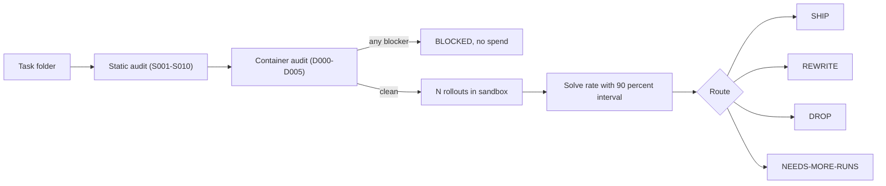

# TaskGate

**An automated QA and calibration gate for human-written RL / SFT tasks.**

TaskGate takes a folder of Docker-based terminal tasks and does the repetitive
checking around them: it audits each task for flaky tests, network use and answer
leaks, proves the reference solution in fresh containers, measures solve rates
with confidence intervals, and routes every task to **SHIP**, **REWRITE**,
**DROP**, **NEEDS-MORE-RUNS** or **BLOCKED**.

The creative work, writing original tasks and judging whether they are fair to
the agent, stays with people. TaskGate takes over the reruns, the arithmetic and
the checklist, and hands people a short list of findings to judge.

Built for teams that produce and QA RL / SFT task datasets.



## Results from a real run

Run on the 8-task demo corpus with Docker Desktop, dynamic audit enabled
(`report.json` and `report.html` are generated by every run).

| Measure | Result |
|---|---|
| Tasks audited | 8 |
| Task images built and reproducible | 8 / 8 |
| Reference solution, 5 fresh containers each | 5 / 5 on 7 tasks; 0 / 5 on `t07_network_dep` |
| Mutation probe (are the tests able to fail?) | 2 / 2 caught on 6 tasks; 2 / 3 on `t08_borderline` |
| Blocker findings | 3 (answer leak, network access, failing reference solution) |
| Warnings | 5 |
| Routing | 2 BLOCKED, 6 clear of blockers (AUDIT-ONLY) |
| Healthy tasks flagged | 0 |
| Model calls needed | None: the audit runs without model spend, and blocked tasks never reach calibration |
| Wall time, whole corpus | 463.7 s, including image builds and 5 reference runs per task |



### What it found

| Task | Planted issue | What TaskGate reported |
|---|---|---|
| `t01_log_parser`, `t02_csv_dedupe` | none (healthy controls) | clean |
| `t03_trivial_rename` | far too easy for a model | clean on the audit; this is a difficulty problem that the solve-rate calibration step measures |
| `t04_ambiguous_spec` | instruction never names the output file | 3 `S009` notes: no output path, no format, unresolved "It" |
| `t05_leaky_tests` | hidden tests copied into the agent's image | **BLOCKER** `S001` at `Dockerfile:5`, with the fix |
| `t06_flaky_timing` | sleep-based sync, unseeded RNG, wall-clock reads | 3 `S007` warnings with file and line, routed to a human |
| `t07_network_dep` | the verifier makes a network call, unpinned dependency | **BLOCKER** `S006` at `tests/test_version.py:8`, **BLOCKER** `D001` (reference failed 0 / 5), `S005` warning |
| `t08_borderline` | near the edge of the target window | `D004` warning: tests caught only 2 of 3 trivial sabotages |

Every finding carries a stable rule ID, a file and line, and a concrete fix hint.

## Live calibration (first real run)

3 tasks x 5 rollouts with `openai/gpt-oss-120b` on Groq's free tier, concurrency 1, temperature 0.7,
max 12 turns. 15 rollouts, all valid, 0 infra errors, 114,173 tokens, $0, 1,814 s wall time.

| Task | Valid | Passed | Tool-call failures | Solve rate (90% Wilson) | Route |
|---|---|---|---|---|---|
| `t01_log_parser` | 5 | 2 | 3 | 40% [14%-73%] | NEEDS-MORE-RUNS |
| `t02_csv_dedupe` | 5 | 5 | 0 | 100% [65%-100%] | REWRITE |
| `t03_trivial_rename` | 5 | 5 | 0 | 100% [65%-100%] | REWRITE |

**What this shows**
- All 3 non-passes on `t01` were `tool_use_failed`: the model wrote a tool call Groq could not parse.
  They are counted as task failures, not infra errors. The 2 rollouts that made valid tool calls both
  passed. So the 40% reflects tool-call reliability in this agent loop as much as task difficulty:
  the same task reads 40% or 100% depending on how those failures are counted.
- `t02` and `t03` are routed REWRITE (too easy for this model). They are not DROP because at N=5 the
  lower bound (65%) cannot reach the 80% DROP threshold.
- `t01` is NEEDS-MORE-RUNS because its interval straddles the target window.

**Limits.** One run per task, N=5, so intervals are wide. The model is a free-tier model driven by a
minimal agent loop, so these rates show the pipeline works end to end; they do not measure difficulty
for frontier models or a client's own scaffold. The demo corpus was not designed to be hard.
The offline `taskgate demo` numbers come from a mock agent and are labelled SIMULATED.

## Tested on a public benchmark

I ran the static audit on 66 Terminal-Bench tasks and hand-read 20 findings. None was a confirmed
defect, so I tightened six rules that were producing false alarms and added regression tests for
each. Static audit only; no container runs or model rollouts were done on these tasks. Details and
limits: [docs/real_findings.md](docs/real_findings.md).

## How it works



1. **Static audit** reads the task with AST and filesystem rules.
2. **Container audit** builds the image twice, runs the reference solution in 5
   fresh containers, runs it with the network off, and sabotages it to see whether
   the tests notice.
3. **Calibration** runs N model rollouts per task in sandboxed containers and
   computes the solve rate with a Wilson interval.
4. **Routing and diagnosis** turn the numbers into a verdict and a short,
   advisory explanation. A person always makes the final call.

## Quickstart

Needs [uv](https://docs.astral.sh/uv/). Docker is only needed for the container audit and live
rollouts.

```bash
uv sync
uv run taskgate demo        # offline walkthrough, no Docker or API key, labelled SIMULATED
```

On your own tasks (see "Supported task layouts" below):

```bash
uv run taskgate audit tasks/ --no-dynamic     # static rules only: no Docker, seconds
uv run taskgate audit tasks/                  # plus container checks (needs Docker)
uv run taskgate calibrate tasks/ --model mock # mock rollouts + stats + routing
uv run taskgate calibrate tasks/ --provider groq --model openai/gpt-oss-120b --rollouts 5 --concurrency 1
uv run taskgate report taskgate_out           # rebuild HTML from report.json
```

Providers: `--provider openrouter|groq|openai-compatible` (with `--base-url` for the last).
Keys come from environment variables only: `OPENROUTER_API_KEY` or `GROQ_API_KEY`. Useful flags:
`--rollouts`, `--concurrency`, `--max-turns`, `--max-tool-output-chars`, `--tpm`, `--ship-min`,
`--ship-max`, `--budget-usd`, `--timeout-s`, `--out`, `--seed`, `--skip-preflight`, `--no-dynamic`.

To view any `report.json` without installing anything, open `docs/index.html` in a browser and drop
the file onto it. It is read locally and never uploaded.

## Rule reference

Rule IDs are stable, so two runs produce diffable reports.

| ID | Check | Severity |
|----|-------|----------|
| S001 | Hidden tests reachable from the agent's filesystem | BLOCKER |
| S002 | Solution or expected-output files baked into the image | BLOCKER |
| S003 | Test assertions compare against literals that also appear in the instruction | WARN |
| S004 | Tests only check existence or non-emptiness | WARN |
| S005 | Unpinned dependencies (`pip install x`, `:latest`) | WARN |
| S006 | Network use in tests or at run time | BLOCKER |
| S007 | Non-determinism in tests (unseeded RNG, wall clock, sleep-based sync) | WARN |
| S008 | Declared output format is not strictly asserted | WARN |
| S009 | Instruction may be ambiguous | INFO |
| S010 | Task can be solved by editing the tests | BLOCKER |
| D000 | Task image failed to build | BLOCKER |
| D001 | Reference solution is flaky or broken across fresh runs | BLOCKER |
| D002 | Tests pass on an unmodified environment | BLOCKER |
| D003 | Hidden network dependency | BLOCKER |
| D004 | Tests miss a trivial sabotage of the solution | WARN |
| D005 | Image build is not reproducible | BLOCKER |

Any BLOCKER stops the task. No calibration spend happens for it.

## Statistics

* **Solve rate** is passes over valid rollouts. Infrastructure failures are
  excluded from the denominator and tracked separately.
* **Wilson score interval at 90%.** It stays inside [0, 1] and behaves well at 0/n
  and n/n. At N = 20, a measured 20% has an interval of roughly 8-42%, so the
  report shows the interval, not just the point estimate.
* **pass@k** uses the unbiased estimator for k in {1, 3, 5}.
* **Routing**, first match wins:

  | Verdict | Condition |
  |---------|-----------|
  | `BLOCKED` | any BLOCKER finding |
  | `NEEDS-MORE-RUNS` | fewer than 5 valid rollouts |
  | `DROP` | upper bound of the interval below the window (too hard), or lower bound at or above 80% (degenerately easy) |
  | `SHIP` | point estimate inside the window (default 10-30%) |
  | `NEEDS-MORE-RUNS` | the interval straddles a window boundary |
  | `REWRITE` | interval sits above the window but is not degenerate, or is out of window and unresolved |

  The **5-valid-rollout floor is fixed** and is deliberately *not* tied to
  `--rollouts`. If a run requests fewer than 5 rollouts, every task comes back as
  `NEEDS-MORE-RUNS` no matter how decisive its point estimate looks: a small
  sample cannot buy a verdict. Ask for at least 5 (the default is 20) to get a
  real route. A recoverable diagnosis (see below) can turn a `DROP` or a
  *straddling* `NEEDS-MORE-RUNS` into `REWRITE`, but it can never override the
  too-few-rollouts verdict.

### Rollout outcomes

Valid rollouts (the solve-rate denominator) are the ones that ran to completion.
Everything else is counted separately rather than hidden inside the failure rate:

* **infra errors** -- the sandbox or provider failed (Docker, timeout, an
  unrecoverable HTTP error). Excluded from the denominator.
* **rate-limited** -- the provider's daily quota ran out; the run stops cleanly and is reported as
  rate-limited. Rerun after the quota resets.
* **tool-call failures** -- the model's *own* tool call was unparseable
  (`tool_use_failed`), even after the per-turn retries. These are counted as task
  failures, but are disclosed separately so they do not silently inflate the
  failure count.

## Diagnosis

For out-of-window tasks TaskGate writes an advisory diagnosis. With
`OPENROUTER_API_KEY` set, a model answers in JSON validated against a closed set
of causes (`underspecified_instruction`, `trivially_solvable`, `test_too_strict`,
`environment_issue`, `genuinely_hard`, `shortcut_available`); answers that fail
validation are discarded. Without a key, zero-cost heuristics are used.

## Safe by construction

* Agent containers run as non-root, with CPU, memory and pid limits, networking
  off unless the task allows it, and the host Docker socket never mounted.
* Hidden tests are mounted only after the agent stops.
* Containers and images are torn down on success, on error and on Ctrl-C.
* Secrets come from environment variables only and never reach a log or report.
* One task failing never aborts the run; each task carries its own status.

## Architecture

```
taskgate/
  cli.py          Typer app: audit / calibrate / run / report / demo
  pipeline.py     audit -> container audit -> calibrate -> diagnose -> report
  models.py       Pydantic v2 models; the JSON schema is the source of truth
  loader.py       the only module that knows the task format
  audit/          rules, static checks, container checks
  runner/         Docker sandbox, agent loop, providers, pacing, mock agent, executor, pricing
  stats/          Wilson interval, pass@k, routing (pure functions)
  diagnose/       heuristic and optional LLM diagnosis
  report/         terminal summary, report.json, single-file offline report.html
  demo/           the 8-task demo corpus builder
tests/            pytest suite for TaskGate itself
docs/index.html   offline report viewer (drop in a report.json)
```

Two adapters are the whole integration surface:

* a different **task format**: edit `loader.py`;
* a different **model or agent scaffold**: implement
  `async def run_rollout(index) -> Rollout`, as in `runner/mock_agent.py` and
  `runner/agent.py`.

### Supported task layouts

TaskGate format (used by the demo corpus):

```
tasks/<task_id>/
  task.yaml            id, instruction, difficulty, timeouts, author, allow_network
  Dockerfile           agent image
  instruction.md       what the agent sees
  tests/               hidden verifier (pytest)
  solution/            reference solution
```

Terminal-Bench / Harbor format:

```
tasks/<task_id>/
  task.toml
  instruction.md
  environment/Dockerfile
  tests/test.sh
  solution/solve.sh
```

The static audit has been run on 66 Terminal-Bench tasks. The container audit and live calibration
on this layout have not been verified end to end. Any other format needs only a change to
`loader.py`.

## Status

| Component | State |
|---|---|
| Static audit (S001-S010) | Built and tested; verified on the demo corpus and on 66 Terminal-Bench tasks |
| Container audit (D000-D005) | Built; verified on Docker Desktop (results above) |
| Calibration engine, routing, reports | Built and unit-tested; validated end to end |
| Live-model calibration | First real run completed (see Live calibration above); N=5 per task, one free-tier model |

## Limitations

* Audit rules are heuristics. Findings go to a person, and TaskGate never
  auto-approves a task.
* Solve-rate intervals at small N are wide; the tool shows them instead of
  hiding them.
* The built-in agent loop is minimal and is not a client's own scaffold, so a
  measured solve rate may differ from theirs. `AgentAdapter` is the extension
  point.
* The live run used a free-tier model with a minimal agent loop and rate-limited quotas, so N is
  small and intervals are wide.
* `taskgate demo` uses a mock agent. Its numbers are simulated, its container findings are simulated
  from task metadata to mirror the recorded Docker run, and every such report carries a visible
  `SIMULATED` banner. The real run is the one under "Results from a real run".

## Roadmap

* Local specialist verifier stack (OpenCV, CLIP, imagehash) for visual and UI
  tasks.
* Terminal trajectory recorder and sanitiser for SFT / PRM JSONL.
* Dataset conversion and MinHash / embedding originality checks.
* Task scaffolding generator.

## Development

```bash
uv sync
uv run pytest
```

The suite has 182 tests (the 3 Docker-dependent ones skip when no daemon is reachable). It covers
every static rule (positive and negative cases), Wilson intervals and pass@k against known values,
the routing table including boundary cases, the budget guard, provider and infrastructure error
handling, mock determinism, and an integration test across all 8 demo tasks.

More detail: [docs/real_findings.md](docs/real_findings.md).